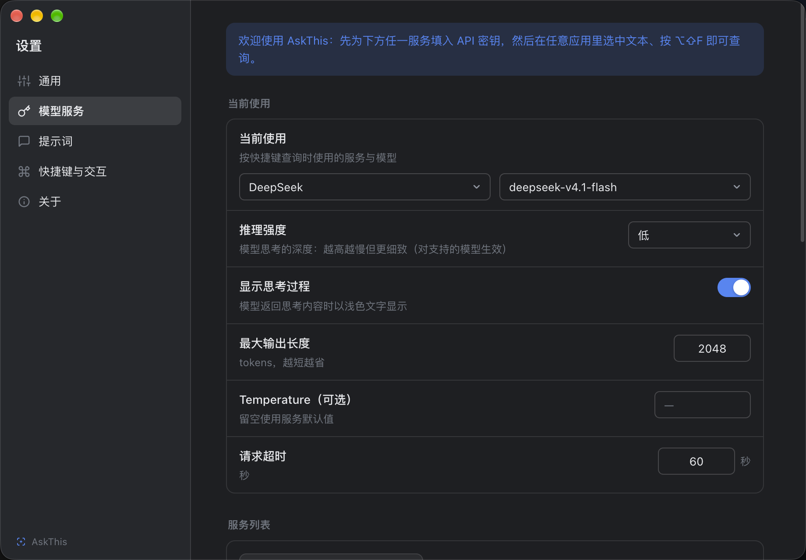
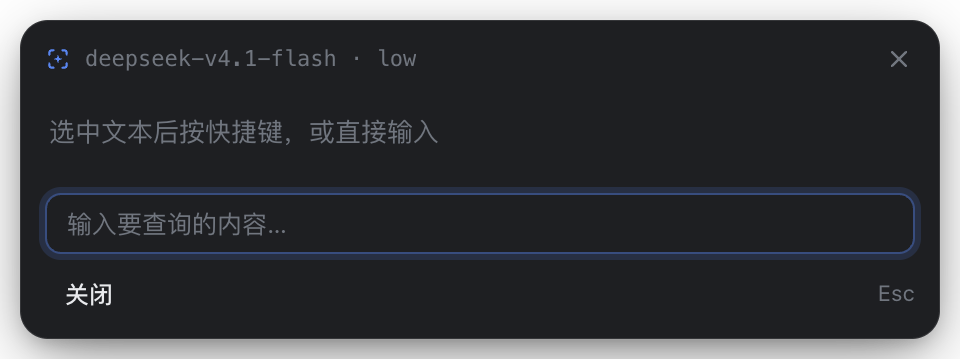
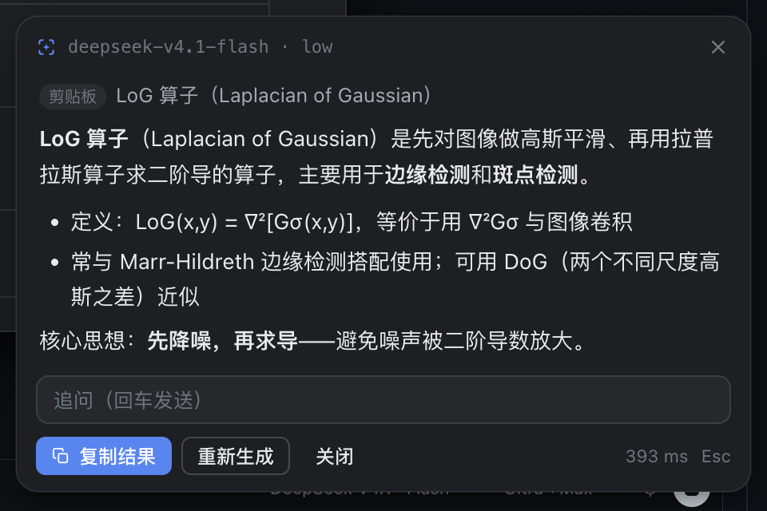

# AskThis Beginner Guide

> No programming required: install the app, connect a model, and ask with one shortcut.

## 1. What is this?

AskThis puts AI in a small card you can open whenever you need it. The default shortcut is **macOS `⌥⇧D` (Option + Shift + D) / Windows and Linux `Alt+Shift+D`**.

- **Have text to look up?** Select a term, passage or code → shortcut → read the explanation or translation.
- **Have a question?** Select nothing → shortcut → type → press `Enter` to send.
- **Have copied text?** Select nothing → shortcut → paste it yourself → press `Enter` to send.

In v0.1.4's default automatic mode, no selection opens an empty input — **it does not automatically submit text you copied earlier**. The input gets focus automatically. Press `Esc` to close the card.

AskThis is free and open source, but does not include cloud model credits. You need your own API key or a running local model service. **A web-chat subscription does not necessarily include API credits**; check your provider's API platform.

## 2. Download & install

Open **[the latest release](https://github.com/537Lab/askthis/releases/latest)** and expand **Assets**. Below, `<version>` means the version shown on that page. **Do not download Source code** to install the app.

### macOS

1. Check **Apple menu → About This Mac**:
   - **Apple M-series chip**: choose `AskThis-<version>-arm64.dmg`.
   - **Intel**: choose `AskThis-<version>-x64.dmg`.
2. Open the `.dmg` and drag **AskThis into Applications**.
3. Launch it from Applications. A manual launch opens Settings; the app normally lives in the menu bar.
4. If macOS blocks it, verify it came from the repository above. Try right-clicking the app → **Open**, or follow **Open Anyway** in System Settings → Privacy & Security. The exact prompts vary by macOS version.

Releases do not have Apple Developer ID signing or notarization. Do not disable system-wide security protections to install them. If you have verified the source but the quarantine flag still blocks launch, you can remove that flag for this app only:

```bash
xattr -dr com.apple.quarantine /Applications/AskThis.app
```

This removes the download quarantine flag from the specified AskThis app. It is not a required routine step.

### Windows

1. For most Intel / AMD PCs, choose `AskThis-<version>-setup-x64.exe`. Windows ARM devices should use the corresponding `arm64` installer when available.
2. Run the installer. If SmartScreen says “Windows protected your PC”, verify the source before choosing **More info → Run anyway**.
3. For no installer, choose the `portable` build. Find the running app in the bottom-right system tray.

### Linux

Download the appropriate `.AppImage` or `.deb`. Linux builds have not been tested on real hardware. X11 selection capture needs `xdotool`; on Wayland, use manual input / paste. Global shortcut support depends on the desktop environment.

> **Platform status:** macOS is the primary validation platform. Earlier Windows releases had install, launch and shortcut checks, but **v0.1.4's new interactions still need Windows hardware re-testing**. Linux has not been tested on real hardware. A package being available does not mean every feature has been verified on that platform.

## 3. Connect an AI service

An API key lets AskThis call a model. It is not your website password, and you should not share it.

Here is an example using DeepSeek; you can use another provider you already have:

1. Visit <https://platform.deepseek.com> and sign up or log in.
2. Create a key in the platform's **API keys** section and store it safely. If payment is required, review the current pricing, credits and billing rules first.
3. In AskThis → **Settings → Providers**, select the existing DeepSeek entry, or use **Add service** if needed.
4. Paste into **API key** and save.
5. Click **Fetch models**, choose a model your account can access, and check that the service and model under **Active** are correct.
6. Optionally use **Test connection**, then try a short question.

The existing screenshot below shows the Chinese UI layout. Its model names and older shortcut hint are not configuration instructions; use the shortcut in this guide.



<details>
<summary><b>Another cloud service or a local model?</b></summary>

- **Other cloud services**: obtain a key from their API platform, choose the matching preset in **Add service**, save the key and select a model.
- **Custom compatible APIs**: enter the documented API URL, interface type, model ID and key. OpenAI-compatible URLs usually end in `/v1`; a web-chat page URL will not work.
- **Ollama / LM Studio**: start the local model and API server first, then configure its address and model in AskThis. Installing the server, downloading models and meeting resource requirements are separate steps.
- Models change. Use **Fetch models** and your account's access rather than copying a model name from an older screenshot.

</details>

## 4. First question: try typing

1. Clear the text selection in your current app — for example, click a normal blank area.
2. Press **`⌥⇧D` / `Alt+Shift+D`**.
3. When the empty card appears, type **“Explain recursion in one sentence.”**
4. Press **`Enter`** to send. Read the streamed answer and use the bottom input for a follow-up.
5. Press **`Esc`** to close. With an IME, confirming a composition candidate does not send the question; `Esc` during composition handles the input method first.



**Try the clipboard safeguard:** copy some unrelated text, clear the selection and press the shortcut. In default automatic mode, you should see an empty input, not an answer about the old text. To ask about copied text, paste it yourself and press `Enter`.

### Then try a selection

1. Select a term or short passage in a webpage or document.
2. Press the same shortcut. A successfully captured selection is queried automatically; no extra Send action is needed.
3. If macOS asks for **Accessibility** access, follow the prompt to System Settings → Privacy & Security → Accessibility, add and enable AskThis, then restart the app and select the text again.
4. If the source app does not expose a readable selection, copy manually, open the card and paste.

The older answer-card example below uses a clipboard source; it does not show the new default behavior:



## 5. Everyday usage & three capture modes

| What you want | How |
| --- | --- |
| Look up a word / passage | Select → shortcut (default automatic mode) |
| Ask a question | No selection → shortcut → type → `Enter` |
| Query copied text | Open an empty card → paste → `Enter` |
| Follow up | Type in the bottom input → `Enter` |
| Copy the answer | Click **Copy**; the card then closes |
| Close the card | `Esc`, the top-right ✕, or **Close** |
| Change provider / model | Settings → Providers |
| Change shortcut | Settings → Shortcut & Interaction |
| Change language / theme | Settings → General |

In **Settings → General → Text capture**:

- **Auto (selection first)**: the default. Query a captured selection; otherwise wait for input. Old clipboard contents are not automatically queried.
- **Manual input**: always open the input card, even if another app has a selection. Useful for quick questions and avoiding simulated copy actions during capture.
- **Clipboard only**: when you explicitly choose this mode, the shortcut reads and queries clipboard text. Be careful not to leave sensitive text there and trigger it accidentally.

## 6. FAQ

### Why does the shortcut no longer query my clipboard with no selection?

This changed in v0.1.4 to prevent old copied text from accidentally becoming a question. In default automatic mode, type or paste into the card. To keep a clipboard workflow, explicitly choose **Clipboard only**.

### The shortcut does nothing

- Check that AskThis is running: look in the macOS menu bar or Windows tray.
- Another app may have claimed the shortcut. Change it in Settings → Shortcut & Interaction; registration failures appear there.
- On Linux, especially Wayland, shortcut support depends on the desktop environment. Include your session type when reporting a problem.

### macOS cannot read selections after an update

An update changes the app signature, so macOS may require access again. Check AskThis under System Settings → Privacy & Security → Accessibility. If toggling does not help, remove the old entry, add AskThis from Applications again, enable it and restart. Keychain prompts require your confirmation. Never paste your password or API key into an issue.

### “Request failed”, “Timed out” or “No API key”

Check the active provider and model, saved key, account balance / model access, and network. If you use a proxy, enable its **system proxy** mode. Being able to use a provider's chat website does not mean API access is enabled.

### What does it cost?

AskThis is free. Cloud APIs charge according to your provider's rules and usage. Try a short query and check usage in the provider console. Lower **Max output tokens** to limit answer length. Local models usually avoid cloud API fees, but use your computer's resources.

### Where does my text go? Is the clipboard sent automatically?

Requests go directly to the model service you configured, not through an AskThis relay. Captured selections are queried automatically; typed / pasted text waits for `Enter`. The default automatic mode does not send old clipboard text; explicit clipboard mode does. History is local and can be disabled or cleared in General settings.

### Can it recognize screenshots, images or scanned PDFs?

No. There is no OCR / screenshot recognition. Extract the text with another tool, then paste it into AskThis.

### Can using it in a terminal affect a running command?

Selection capture may simulate Copy. On Windows / Linux, `Ctrl+C` can interrupt a terminal process. Choose **Manual input** first, then type or paste into the card. Copy fallback also cannot guarantee complete restoration of non-text clipboard contents such as images.

---

[Project homepage](../README.en.md) · [中文教程](quick-start.zh-CN.md) · [Report an issue](https://github.com/537Lab/askthis/issues)

Include your app version, OS version, capture mode and reproduction steps. Do not include API keys or sensitive text.
