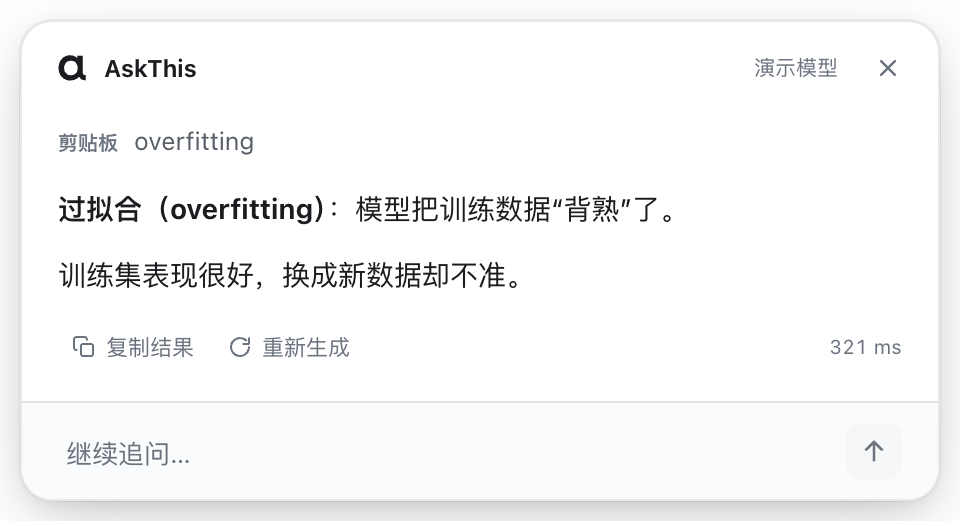
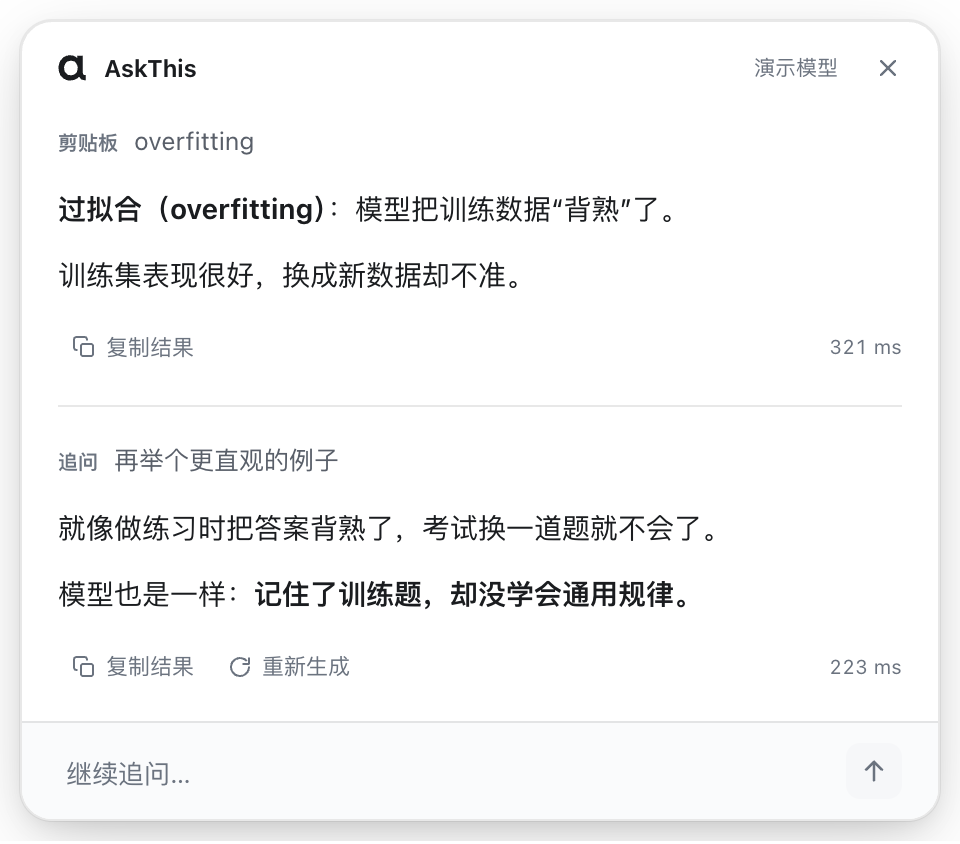

# AskThis v0.1.5 · 速查更轻，追问更连贯

## 中文

这次不是再加一个大聊天窗口，而是把随手查询的过程打磨得更顺。

### 更新了什么

- **更紧凑的速查卡片。** 追问入口平时保持单行，需要多行输入时再展开；仅点击输入框不会把窗口撑高。原文自然换行，答案保持清楚的阅读层级。
- **连续追问更顺手。** 支持 `Shift+Enter` 换行、发送按钮；生成回答时可以先写下一问，等回答完成或停止后再主动发送，不会自动排队或并发提交。
- **复制不再关掉卡片。** 每条已有答案都可以独立复制，复制后继续追问；最后一轮保留重新生成入口，包括提前停止和空回答的情况。
- **阅读历史不被拉回底部。** 向上滚动会暂停跟随，点「回到最新」恢复；小窗口下的多行草稿内部滚动，不挤掉操作按钮。
- **统一的新图标。** 应用、速查卡片、设置页和原生菜单栏／托盘采用同一套「对话 a」标志，并修正原生图标资源的打包路径。
- **修复 Mac 中文候选栏遮挡。** 保留全屏 Space 显示，同时让系统拼音／双拼候选栏正常出现在卡片上方。
- **恢复 Mac 设置窗口拖动。** 拖动顶部空白区域或左侧「设置」标题即可移动，导航和表单仍能正常点击。

选中即问、无选区直接输入、多服务商和本地模型都是已有能力；**无选区打开空白输入框、默认不自动提交旧剪贴板，自 v0.1.4 起已支持**，不是这次才新增。

### 下载与开始使用

在本 Release 的 **Assets** 中选择安装包，不用下载 Source code：

| 设备 | 文件名 |
| --- | --- |
| Mac · Apple Silicon（M 系列） | `AskThis-0.1.5-arm64.dmg` |
| Mac · Intel | `AskThis-0.1.5-x64.dmg` |
| Windows · 常见 Intel / AMD 电脑 | `AskThis-0.1.5-setup-x64.exe` |
| Windows · ARM 电脑 | `AskThis-0.1.5-setup-arm64.exe` |
| Windows · 便携版 | `AskThis-0.1.5-portable-x64.exe` |
| Linux | `.AppImage` 或 `.deb` |

安装 → 配置自己的模型服务 → 按 `⌥⇧D`（Mac）／`Alt+Shift+D`（Windows、Linux）。有选区就查，没有选区就输入，按 `Enter` 发送。

- 软件免费开源；**自备 API 密钥，云端 API 费用由服务商另行收取**，也可接 Ollama／LM Studio 本地模型。网页聊天会员不是 API 密钥。
- **Mac 升级提醒：** 当前为 ad-hoc 签名，未做 Apple Developer ID 签名／公证。更新后可能需要重新授予辅助功能和钥匙串访问；若辅助功能开关无效，移除旧条目，重新添加「应用程序」中的 AskThis、开启并重启。不要关闭系统级安全保护。
- 不含 OCR／截图识字；无法读取选区时可自行复制后粘贴。文字捕获取决于目标应用及系统权限。
- **平台验证：** macOS 是主要真机验证平台；Windows 旧版有安装、启动和快捷键记录，但 v0.1.4–v0.1.5 新交互仍待 Windows 真机复验；Linux 尚未真机验收。提供安装包不等于每个平台的每项功能都已实测。

### 验证记录

- 单测 **36/36**、主进程与界面类型检查、生产构建均通过。
- 当前打包版 Mac 输入法／桌面与全屏回归 **25/25**、设置窗拖动回归 **6/6**；输入法范围仅系统拼音／双拼，不泛化到所有第三方输入法。
- [精简验收记录](verification-v0.1.5.json) · [中文新手教程](../quick-start.zh-CN.md) · [完整更新日志](../../CHANGELOG.md)

截图为实际打包版界面，内容来自本地演示服务，不代表线上模型的回答效果或速度。

---

## English

### A lighter lookup, smoother follow-ups

This release refines quick questions at your fingertips instead of turning the card into another large chat workspace.

- **A more compact card.** Keep the follow-up entry single-line until multiline input needs space. Focus alone does not expand the window. Source text wraps naturally while the answer remains the reading focus.
- **Smoother follow-ups.** Use `Shift+Enter` and the Send button. Draft your next question during generation, then send explicitly after completion or stopping—no automatic queue or concurrent submission.
- **Copy without closing.** Copy each existing answer independently and keep talking. Regenerate the latest turn, including after early stopping or an empty answer.
- **Read without being pulled back.** Scrolling up pauses following; **Back to latest** resumes it. Multiline drafts scroll internally in small windows to preserve the controls.
- **A consistent new identity.** The “Dialogue a” mark across the app, popup, Settings and native menu bar / tray, with corrected native resource packaging.
- **Mac fixes.** System Pinyin / Shuangpin candidates remain visible above the card, including in fullscreen Spaces. Drag Settings using its top blank strip or sidebar title without interfering with controls.

Selection lookup, direct typing, multiple providers and local models already existed. **No-selection input and the safe default clipboard behavior shipped in v0.1.4**, not for the first time in v0.1.5.

### Download and start

Choose a package from this Release's **Assets**; you do not need Source code. Use `arm64.dmg` for Apple silicon, `x64.dmg` for Intel Macs, `setup-x64.exe` for typical Intel / AMD Windows PCs, or `setup-arm64.exe` for Windows on ARM. A portable Windows build and Linux AppImage / deb packages are also provided.

Install → configure your model service → press `⌥⇧D` (Mac) / `Alt+Shift+D` (Windows, Linux). Select text to query it; with no selection, type and press `Enter`.

- Free, open-source app; **bring your own API key and pay your cloud provider separately**, or use Ollama / LM Studio. A web-chat subscription is not an API key.
- Mac builds are ad-hoc signed, not Developer ID signed / notarized. An upgrade may require Accessibility and Keychain authorization again. If toggling Accessibility does not work, remove the old entry, re-add AskThis from Applications, enable it and restart. Do not disable system-wide security.
- No OCR / screenshot recognition. Capture depends on the target app and permissions; copy and paste manually when necessary.
- macOS is the primary hardware-validation platform. Earlier Windows releases have install, launch and shortcut records, but the v0.1.4–v0.1.5 interactions still need Windows hardware re-testing. Linux has not been hardware-validated. Package availability is not proof of complete platform validation.

### Checks

**36/36 unit tests**, both TypeScript checks and the production build passed. Separate current packaged Mac regressions passed **25/25** IME / desktop / real-fullscreen checks and **6/6** Settings-drag checks. IME coverage is system Pinyin / Shuangpin, not every third-party input method.

[Verification summary](verification-v0.1.5.json) · [Beginner guide](../quick-start.md) · [Changelog](../../CHANGELOG.md)

The screenshots above are real packaged app UI with local demonstration content, not online-model quality or speed benchmarks.
